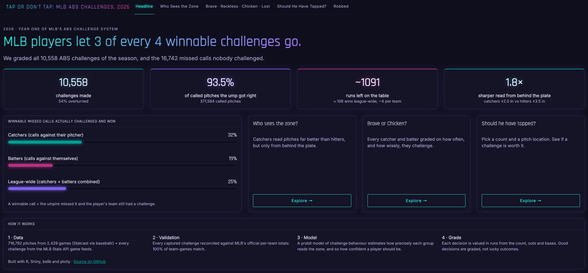
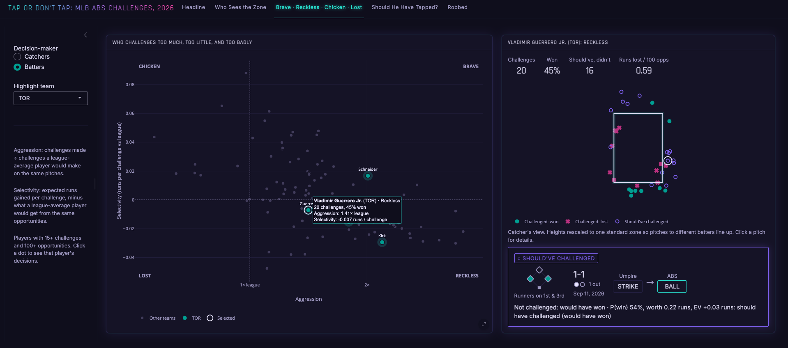
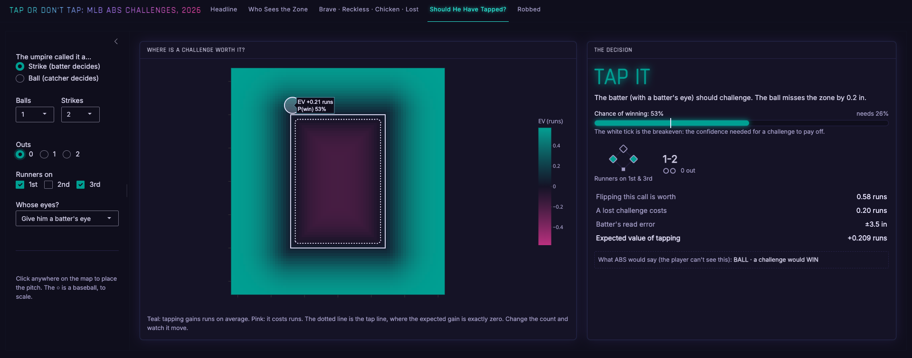
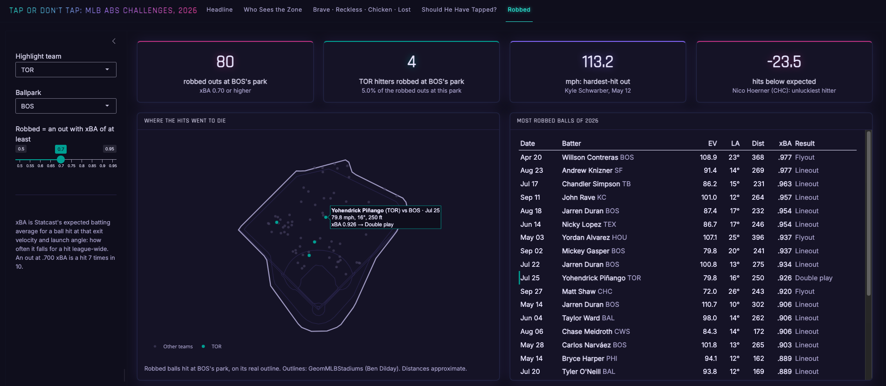
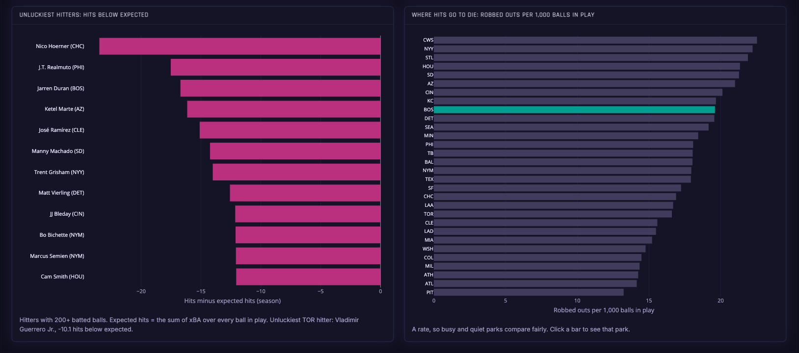

# Tap or Don't Tap

### Grading every robot-umpire challenge decision of the 2026 MLB season

**[▶ Open the live app](https://sportspire.shinyapps.io/abs-challenge-analytics/)** · Built in R + Shiny · 716,792 pitches · 10,558 challenges



---

## The 30-second version

In 2026, Major League Baseball let players **challenge the umpire's ball-and-strike calls**. If a player thinks the ump got it wrong, he taps his helmet or cap, and a camera system that tracks every pitch replays the call within seconds. If the player was right, the call flips. If he was wrong, his team loses one of its limited challenges.

That makes every close pitch a split-second bet: **is this call wrong enough, and important enough, to risk a challenge?**

This project graded every one of those bets for the whole season, including the ones nobody made. It answers three questions:

1. **Who can actually see the strike zone?** (Catchers, by a lot.)
2. **When is a challenge worth it?** (It depends on the game situation more than most players act like it does.)
3. **Who's making good calls, and who's leaving runs on the table?**

---

## What we found

| | |
|---|---|
| **Umpires were right 93.5% of the time** | Across 371,584 called pitches. Players challenged 10,558 times and won **54%** of them. |
| **Catchers read the zone ~1.8× more precisely than batters** | A catcher's sense of where a pitch crossed is off by about **2.0 inches**; a batter's by about **3.5 inches**. |
| **The edge belongs to the seat, not the player** | When those same catchers step into the batter's box, their read looks like everyone else's. The view from behind the plate is the advantage. |
| **About 3 of every 4 winnable challenges never happen** | **16,742** missed calls went unchallenged. Catchers challenged and won on 32% of their winnable calls, batters on only 19%. |
| **≈1,091 runs left on the table league-wide** | That's the total value lost to skipped good challenges and wasted bad ones: roughly **109 wins**, or about 4 per team. |
| **Bonus: the unluckiest hitter** | Nico Hoerner made **23.5 fewer hits** than the quality of his contact predicted. |

---

## What's in the app

| Tab | What it shows |
|---|---|
| **Headline** | The big numbers: how many challenges were made, won, and how many should have been made but weren't. |
| **Who Sees the Zone** | Catchers vs. batters: how precisely each group judges a pitch, with uncertainty shown honestly. |
| **Quadrant** | Every regular player plotted by *how often* they challenge vs. *how well they pick* their spots. Click a player to see each decision on a strike-zone map, with the game situation (count, outs, runners on base). |
| **Calculator** | Set up any situation (count, outs, runners) and see exactly how close a pitch has to be before tapping is worth it. |
| **Robbed** | A bonus: hard-hit balls that *should* have been hits but were caught, drawn on the **real outline of every MLB ballpark**. |






---

## How it works

Every challenge decision comes down to three things:

### 1. How likely am I to win?
The closer a pitch is to the edge of the zone, the harder it is to tell. We measured how precisely players actually judge pitches by looking at **which pitches they chose to challenge and which they let go**, across the entire season. That gives each group a "blur": how fuzzy the strike zone looks from where they stand. A pitch 4 inches off the edge is an easy call for a catcher; for a batter it's closer to a coin flip.

### 2. How much is the flip worth?
Not every wrong call matters equally. Turning strike three into ball four with the bases loaded is worth nearly **two runs**. Flipping a 0-0 strike with nobody on base is worth a sliver of one. We built our own table of how many runs each game situation is worth, from every half-inning of the 2026 season, and used it to price every possible flip.

### 3. What does losing cost?
A failed challenge burns one of your team's two. We priced that at **0.2 runs**.

**The rule:** tap when *(chance of winning × value of the flip)* is bigger than *(chance of losing × cost of losing)*. Everything in the app (the calculator's tap line, the player grades, the "runs left on the table") comes from that one comparison.

### Grading players
Each player gets two scores:
- **Aggression:** how often they challenge, compared with how often they *should*.
- **Selectivity:** how good their challenges are, compared with what we'd expect.

Those put every player into one of four groups: **Brave** (challenges a lot, picks well), **Reckless** (challenges a lot, picks badly), **Chicken** (picks well but doesn't challenge enough), and **Lost** (neither).

---

## For the baseball nerds

<details>
<summary><b>The strike zone, exactly as the ABS system defines it</b></summary>

- The plate is 17 inches wide. A pitch is a strike if **any part of the ball** touches the zone, so the effective zone is padded by the ball's radius (~1.45 in).
- Each batter's zone top and bottom come from Statcast's `sz_top` / `sz_bot`. We use each batter's most common values, not each pitch's, so one weird stance doesn't move the zone.
- For every pitch we compute a **signed distance to the zone edge** (inside = negative), handling the corners properly instead of treating the zone as two separate bands.
</details>

<details>
<summary><b>The read-noise model (how "blur" is measured)</b></summary>

A probit regression on every challenge opportunity:

`challenged ~ distance_from_edge + z_breakeven`

The breakeven term absorbs *how much the situation made a challenge worth it*, so the slope on distance isolates pure perception. The read noise is **σ = 1 / slope**, in inches:

- Catchers: **σ ≈ 1.99 in**
- Batters: **σ ≈ 3.51 in**

The chance of winning a challenge on a pitch *d* inches past the edge is then **Φ(d / σ)**. The "seat vs. player" finding comes from fitting the same catchers separately in each role. Their edge disappears when they bat.
</details>

<details>
<summary><b>Our own run-expectancy table (RE288)</b></summary>

Statcast's built-in `delta_run_exp` turned out to be too compressed for this. A walk vs. a strikeout with the bases loaded on 3-2 came out far smaller than real run values. So we built a full **288-state table** (8 base states × 3 outs × 12 counts) from the season itself:

- **Runs to end of inning** for every pitch, using the score at the first pitch of the next half-inning. We dropped bottom-9th, extra innings and each game's final half-inning, where innings end early or never finish.
- **Sparse states are shrunk** toward an additive model (K = 30), so a state seen 12 times doesn't produce a wild estimate.
- Count transitions: ball four forces runners ahead only as far as they must go; strike three adds an out, or ends the inning.
- **Weighted isotonic regression** (PAVA plus alternating projections across the count grid) enforces common sense: an extra ball never hurts the hitter, and an extra strike never helps him. Raw data broke that in 5 of 288 states because of small samples and selection effects (e.g. pitchers working around hitters with first base open).

Sanity check: the 0-0 count values line up with standard MLB run expectancy (0.51 runs with the bases empty and nobody out, ~2.5 with the bases loaded). A 3-2 pitch with the bases loaded and 1 out is worth **1.89 runs** to flip.
</details>

<details>
<summary><b>Decision value, grades and "runs left on the table"</b></summary>

- Win probability `p = Φ(d / σ)`, flip value `v` from RE288, loss cost `c = 0.2` runs.
- **EV = p·v − (1 − p)·c**. Tap when EV > 0, which means **p > c / (c + v)**.
- **Regret** sums missed positive-EV challenges and taken negative-EV ones, reported per 100 opportunities.
- Players need ≥100 opportunities and ≥15 challenges to be graded.
- We track each team's challenges remaining at every pitch (2 per game, keep it if you win, plus the extra-inning top-up rule), so a player isn't graded on a pitch he had no challenge left for.
</details>

<details>
<summary><b>The Robbed tab</b></summary>

- "Robbed" = a batted ball that became an out despite an **expected batting average (xBA)** of .700 or higher (adjustable). In other words, contact like that falls for a hit at least 7 times in 10.
- Spray coordinates are converted to feet from home plate and drawn over real park outlines from [GeomMLBStadiums](https://github.com/bdilday/GeomMLBStadiums) (Ben Dilday, MIT license).
</details>

---

## How we know the data is right

Challenges aren't in the standard Statcast data, so we pulled them from MLB's game feeds for all 2,429 games. **The first pass undercounted badly: 2,110 team-games didn't match MLB's official challenge totals.**

The fixes, one bug at a time:
1. Many challenges are logged on the **play**, not the pitch. We added play-level parsing.
2. The very last mismatch was an ABS challenge **nested inside a different kind of replay review**. We added nested-review parsing and re-fetched only the affected games.

**Final result: 10,558 challenges, and every team-game matches MLB's official totals (0 mismatches).**

Other checks:
- Statcast records the call *after* a challenge, so we rebuilt each pitch's **original** call before grading anything.
- 45 automated tests (`testthat`) cover the zone geometry, challenge counting and the run-expectancy math.

---

## Limitations

- **Seat vs. player isn't fully separable.** Catchers and batters differ in what they're doing as well as where they stand. The catcher role effect is real; the exact cause is an interpretation.
- **Pitcher challenges are credited to the catcher**, since the two decide together.
- **The 0.2-run cost of a lost challenge is a fixed estimate.** In reality it's worth more early in a game and less late.
- **Two rare game states come out at zero value** after the smoothing, so the calculator always says "hold" there.
- **The 15-challenge minimum** leaves out the most passive hitters, which skews batter groups toward the aggressive side.
- **Runner-on-third situations** have small samples.
- **The A's and Rays outlines** may not match the parks they played in during 2026.
- On the zone map, the dotted tap line marks the **center** of the ball; the distances in the side panel are measured to the ball's **edge**.

---

## Run it yourself

```r
# 1. Install the exact package versions
renv::restore()

# 2. Build the data (first run downloads a full season and takes a while; results are cached)
source("R/fetch_statcast.R")      # pitch-by-pitch Statcast data
source("R/fetch_challenges.R")    # ABS challenges from MLB game feeds
source("R/build_dataset.R")       # zone distances, run-expectancy table, take values
source("R/model.R")               # read-noise model + player grades
source("R/export_app_data.R")     # slim files for the app

# 3. Run the tests and launch the app
testthat::test_dir("tests/testthat")
shiny::runApp("app")
```

```
R/                 data pipeline (fetch → build → model → export)
app/app.R          the Shiny app
app/app_data/      pre-computed data the app reads
tests/testthat/    unit tests
```

---

## Built with
R · Shiny · bslib · plotly · dplyr · arrow · baseballr · MLB Stats API · Statcast · GeomMLBStadiums

**Abhi Patel** · [GitHub](https://github.com/ap001AP)
